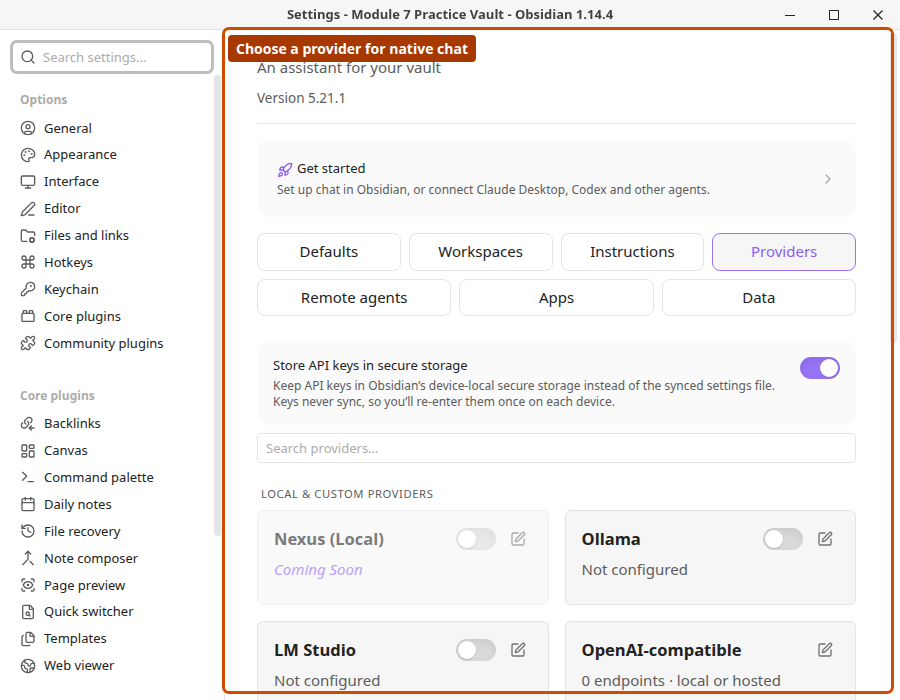

# Provider Setup

*Released Nexus 5.21.1 practice-vault capture. Connect and test your own provider; a provider card does not prove authentication.*

Use this guide if you want to chat with Nexus directly inside Obsidian.

Open **Settings -> Nexus -> Providers**, choose a provider, connect it, then select a model in chat.

---

## Choose a Provider Type

| Type | Best for | Examples |
|------|----------|----------|
| API key | Fastest cloud setup | Anthropic, OpenAI, Google AI, Groq, Mistral, OpenRouter, Perplexity, Requesty |
| Local desktop runtime | Local models on your machine | Ollama, LM Studio |
| OpenAI-compatible endpoint | Your own server or gateway that speaks the OpenAI Chat Completions API | Any endpoint you add by URL |
| Existing subscription or local CLI | Reuse an existing login instead of managing API keys | Claude Code, Antigravity CLI, GitHub Copilot, Codex via ChatGPT |

---

## What Provider Setup Unlocks

- **Standard text chat**: any configured chat provider works in the chat model picker
- **New model options**: Claude Haiku 5.5 is available through Anthropic, Claude Code and OpenRouter. Mistral Large 4 (Le Chonk, public preview) is available through Mistral, OpenRouter and Requesty. Availability through a subscription depends on the account and installed CLI.
- **Image generation and editing**: configure an OpenAI key to select GPT Image 2.5 Sunburst or Flare. Both use medium quality and accept reference images. Adding these models does not change your saved default.
- **Live voice**: configure OpenAI, Google AI, or AssemblyAI, then choose the live voice provider/model in **Settings &rarr; Nexus &rarr; Defaults &rarr; Voice**. See [Native Chat](native-chat.md) for which models run the whole conversation and which only transcribe
- **Read aloud and `generateAudio`**: configure a speech-capable backend such as OpenAI, ElevenLabs, Google AI, Mistral, or OpenRouter, then choose defaults in **Settings &rarr; Nexus &rarr; Defaults &rarr; Voice**. This is a different surface from live voice and is not OpenAI-only
- **`generateVideo`**: configure Google AI or OpenRouter, then choose defaults in **Settings &rarr; Nexus &rarr; Defaults &rarr; Video**

If you want ElevenLabs voices, sound effects, or music generation, enable the ElevenLabs app in **Settings &rarr; Nexus &rarr; Apps** and see [Apps](apps.md).

---

## API Key Providers

For Anthropic, OpenAI, Google AI, Groq, Mistral, OpenRouter, Perplexity, and Requesty:

1. Open **Settings -> Nexus -> Providers**
2. Select the provider
3. Paste your API key
4. Wait for automatic key validation to finish
5. Open Nexus chat and select one of that provider's models

Key edits save automatically, including when you close the configuration window. A new connection is enabled after validation succeeds. Validation never depends on a particular model, so a model the provider has retired cannot fail it. Models the provider no longer offers are marked **No longer available** in the model list and cannot be turned on; your saved setting is kept in case the model returns. To replace a key, select the entire existing value before pasting; surrounding whitespace is removed automatically. On mobile, the input fills its own row, with **Get key** below it.

If you want the simplest setup, an API key provider is usually the fastest path.

Google AI includes **Gemini 4 Argon** in its model picker, with streaming responses, reasoning controls and Nexus tool calling. Select it after configuring your Google AI API key; model availability depends on your provider account.

### Settings across devices

With Nexus 5.20.3 or later on every device, background workflow checks preserve newer synced settings, and Nexus applies incoming provider settings without a restart. Other settings, such as the storage location, require reloading Nexus. Allow your sync service to finish before expecting another device to use an updated key. Simultaneous edits to the same setting still follow your sync service's conflict rules.

### Secure key storage (optional)

By default, API keys live in the plugin's settings file (`data.json`), which syncs with your vault. To keep keys out of synced files, enable **Store API keys in secure storage** in the Providers tab (requires Obsidian 1.11.4+). Keys (including OAuth tokens and app credentials) move into Obsidian's device-local secure storage and are stripped from `data.json` — you will need to re-enter them once on each device. Turning the toggle off writes keys back into `data.json`.

---

## Local Providers

### Ollama

1. Install [Ollama](https://ollama.com/)
2. Make sure Ollama is running and you have at least one model available locally
3. In Nexus, open **Settings -> Providers -> Ollama**
4. Confirm the local endpoint and choose a model in chat

### LM Studio

1. Install [LM Studio](https://lmstudio.ai/)
2. Start the local server in LM Studio
3. In Nexus, open **Settings -> Providers -> LM Studio**
4. Confirm the local endpoint and choose a model in chat

Both local runtimes support **tool calling**, so a capable local model can drive agentic chats (Ollama also auto-discovers every model you have installed). For reasoning models, reasoning streams into a collapsible accordion in chat and is available in the tool-inspection view. The chat header stays animated through generation and settles to **Reasoning** when the response ends.

---

## OpenAI-compatible Endpoints

Use this to connect any local or hosted server that exposes the OpenAI Chat Completions API. You can add several endpoints; each keeps its own address, key and model list.

1. Open **Settings -> Nexus -> Providers** and choose **OpenAI-compatible**
2. Click **Add endpoint**
3. Enter a **Name** (shown in the model picker) and the **API base URL**, including any path such as `/v1`
4. Enter an **API key** only if your server requires one; it is sent as a Bearer token
5. Click **Connect** to discover the server's models through `/models` (including any server-reported context window and reasoning metadata such as `supported_reasoning_levels` or `thinking`), then choose which ones to show in the model picker. If the server returns no list, use **Add a model manually** and enter the exact model ID it expects

Chat and standard tool calling work through these endpoints. Each model row also lets you adjust and verify its context window with **Check**, or click **Probe** to send minimal test requests that detect which thinking effort tiers your server accepts for that model. The endpoint must be reachable from the device you are using, so a `localhost` address only works on that computer.

---

## Responses-compatible Endpoints

Use this to connect any gateway or proxy that exposes the OpenAI Responses API (`/v1/responses`), such as CLIProxyAPI, Sub2API, LiteLLM, NewAPI, or custom proxies. You can add several endpoints; each keeps its own address, key, continuation mode, and model list.

1. Open **Settings -> Nexus -> Providers** and choose **Responses-compatible**
2. Click **Add endpoint**
3. Enter a **Name** (shown in the model picker) and the **API base URL** (for example `https://api.example.com/v1` or a gateway base path ending in `/v1` or `/codex`)
4. Enter an **API key** only if your gateway requires one
5. Choose the **Continuation mode** your gateway supports:
   - **Stateless (full input replay)** (default): replays full conversation items and tool calls on each turn with `store: false` — recommended for CLIProxyAPI, Sub2API, and Codex-backed gateways
   - **Stateful (previous response ID)**: tracks server-side state via `previous_response_id` for gateways that persist response state
6. Select the **Auth header** expected by your endpoint (`Authorization: Bearer`, `API key header`, or `Both headers`)
7. Click **Connect** to discover models through `/models` (reading server-advertised reasoning tiers such as `supported_reasoning_levels` or `thinking` when provided), then enable the models you want. If the server returns no list, use **Add a model manually** and enter the exact model ID it expects

Each model's context window uses the size your server reports when available, or can be edited and verified with **Check**. Click **Probe** on any model row to detect which thinking effort tiers your server accepts and unlock them in chat settings immediately.

---

## Anthropic-compatible Endpoints

Choose **Anthropic-compatible** in Providers and add an endpoint with a name, API base URL, and optional API key. Select the authentication header your server expects (`x-api-key`, bearer, or both), then click **Connect** to discover models and any server-advertised reasoning tiers (`supported_reasoning_levels` / `thinking`). Enable the models you want, or add exact model IDs manually. You can adjust and verify each model's context window with **Check**, click **Probe** to detect supported thinking effort tiers per model, and delete an endpoint from its list card.

---

## Antigravity-compatible Endpoints

Choose **Antigravity-compatible** in Providers and add your gateway's name, base URL, and optional API key. Select its authentication header and protocol: **Auto** routes Gemini models through v1beta and Claude models through Messages; the other modes force one protocol. Click **Connect** to discover models and any server-advertised reasoning tiers (`supported_reasoning_levels` / `thinking`), or add exact IDs manually, then enable the models you want. Context windows can be adjusted and checked with **Check**, and **Probe** detects supported thinking effort tiers per model across the selected protocol. These endpoints are distinct from the desktop Antigravity CLI.

---

## Claude Code

Use this if you already have [Claude Code](https://claude.ai/download) installed and signed in.

1. Install Claude Code and run `claude` in your terminal to sign in
2. In Nexus, go to **Settings -> Providers -> Anthropic**
3. Click **Connect** under **Claude Code**
4. In chat settings, select a model labeled **(Claude Code)**, such as **Claude Sonnet 5.5 (Claude Code)**

Messages route through your local Claude CLI using your existing subscription. Desktop only.

---

## Antigravity CLI (Google)

Run Google's Gemini models locally through the **Antigravity CLI** (`agy`) using your existing Google account — no API key needed. (This replaces the older Gemini CLI runtime; your existing settings carry over.)

1. Install the Antigravity CLI (`agy`)
2. Run `agy` once in your terminal and complete the Google browser sign-in (there is no `agy auth` command)
3. In Nexus, go to **Settings -> Providers -> Google AI**
4. Wait for the **Antigravity CLI** section to show **Connected**
5. In chat settings, select an Antigravity (Gemini) model and set the thinking level with the effort slider

Messages route through the local Antigravity CLI using your existing Google account. This runtime is **text-completion only — it does not support tool/function calling**, so choose a tool-capable provider for agentic chats. Desktop only.

---

## GitHub Copilot

Use this if you have an active [GitHub Copilot](https://github.com/features/copilot) subscription.

1. In Nexus, go to **Settings -> Providers -> GitHub Copilot**
2. Click **Connect**
3. Copy the device code shown in Nexus, then complete the GitHub auth flow in the browser window that opens
4. After authorization, choose one of the fetched Copilot models in chat

Available on desktop and mobile. Experimental.

---

## Codex Via ChatGPT

Use this if you have an active ChatGPT Plus or Pro subscription and want supported OpenAI models through your ChatGPT login. Model access depends on your account and the subscription endpoint.

1. In Nexus, go to **Settings -> Providers -> OpenAI**
2. Click **Connect** under **ChatGPT (Codex)**
3. On desktop, sign in with your ChatGPT account in the browser window that opens. On mobile, copy the device code shown in Nexus and enter it on the sign-in page; enable device-code sign-in in your ChatGPT security settings if requested
4. In chat settings, select a model labeled **(ChatGPT)**

Available on desktop and mobile. Experimental. Closing the provider window cancels pending device-code sign-in for ChatGPT and GitHub Copilot.

ChatGPT and GitHub Copilot sign-in is checked per device. If synced settings show an account connected elsewhere but this device has no token, Nexus offers to reconnect here. Sign in separately on each device.

If ChatGPT rejects a saved refresh token during a Codex request, Nexus shows a notice and changes the provider card to **Reconnect with ChatGPT**. Open the OpenAI provider settings and reconnect to continue. Opening Settings alone does not check the connection.

---

## OpenRouter OAuth

If you prefer OpenRouter browser sign-in instead of an API key:

1. In Nexus, go to **Settings -> Providers -> OpenRouter**
2. Choose the connect or sign-in option
3. Complete the browser auth flow
4. Select an OpenRouter model in chat

If you already have an OpenRouter API key, that is usually the simpler route.

---

## Remote Agents Are Not Providers

**Settings -> Nexus -> Remote agents** connects a separate agent (Hermes or OpenClaw) that runs its own tools and that Nexus can hand tasks to. It does not add models to the model picker. See [Native chat](native-chat.md#remote-agents).

---

## Next Guides

- [Native chat](native-chat.md)
- [Recommended system prompt](recommended-system-prompt.md)
- [MCP setup](mcp-setup.md)
