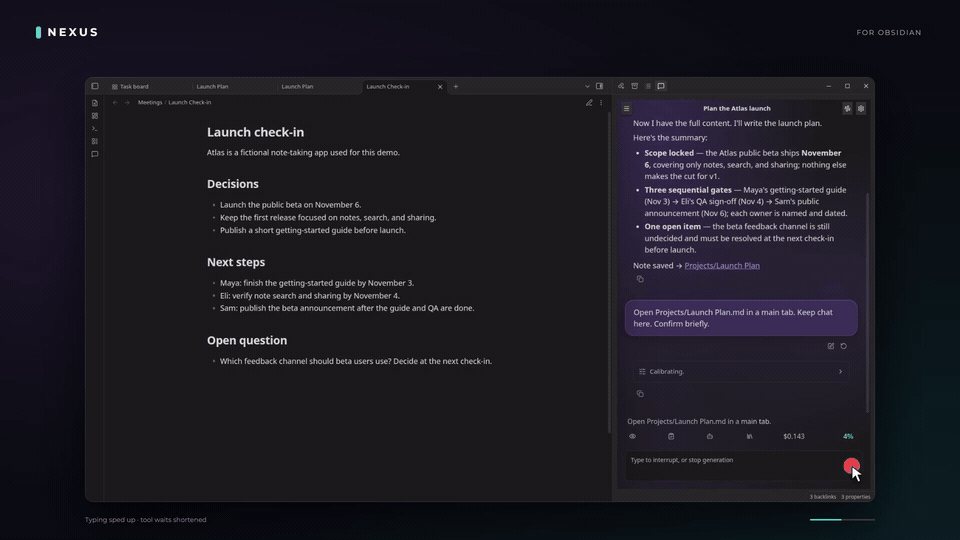
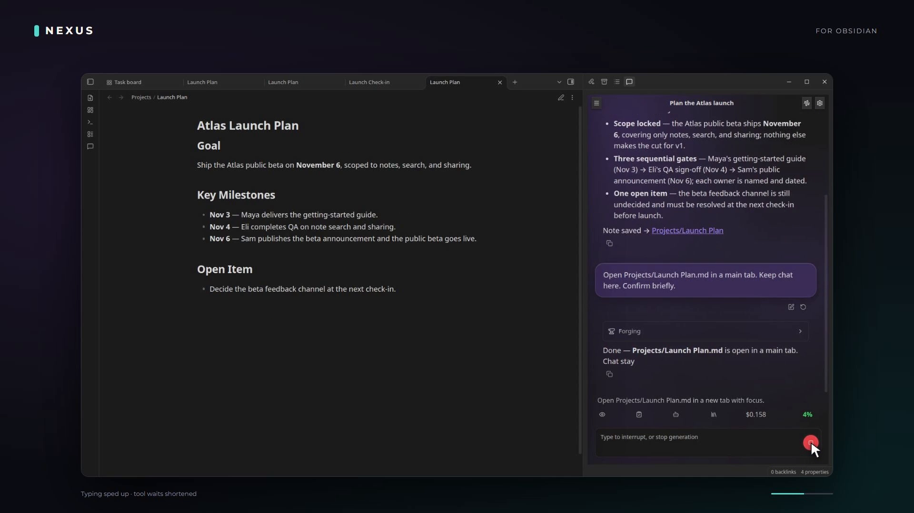
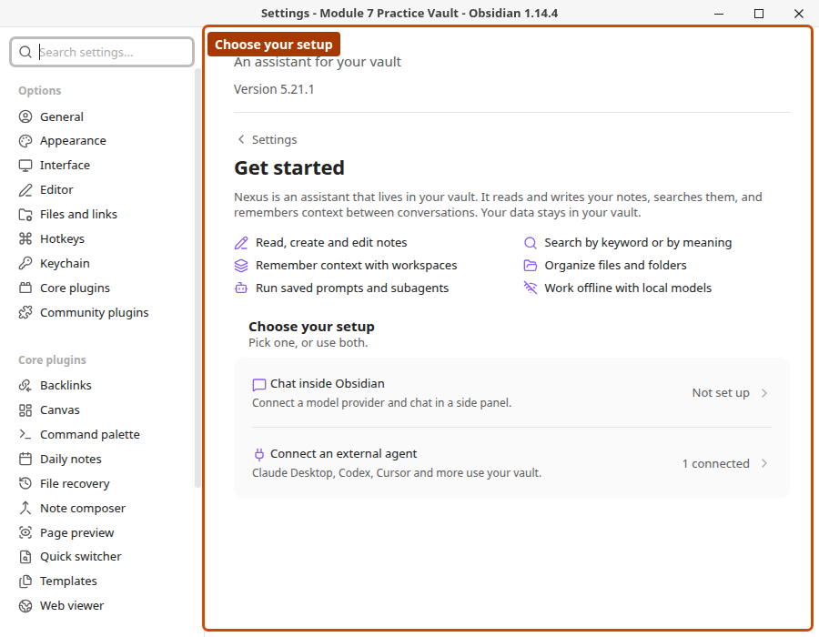
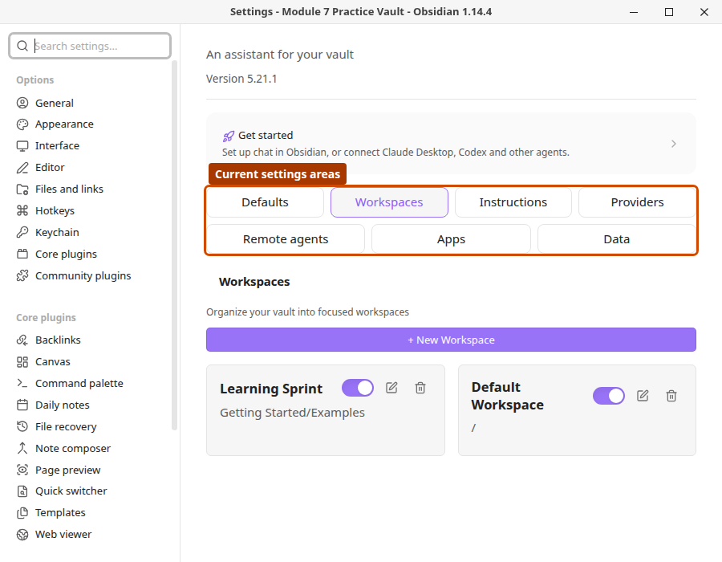
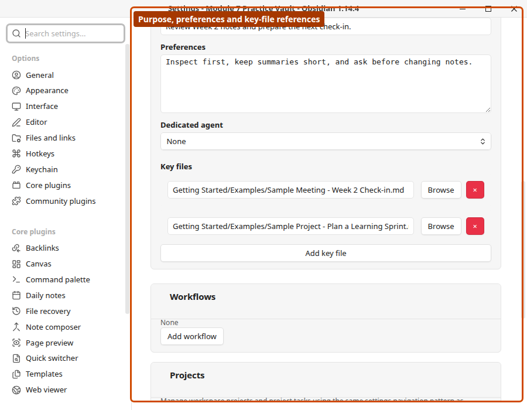
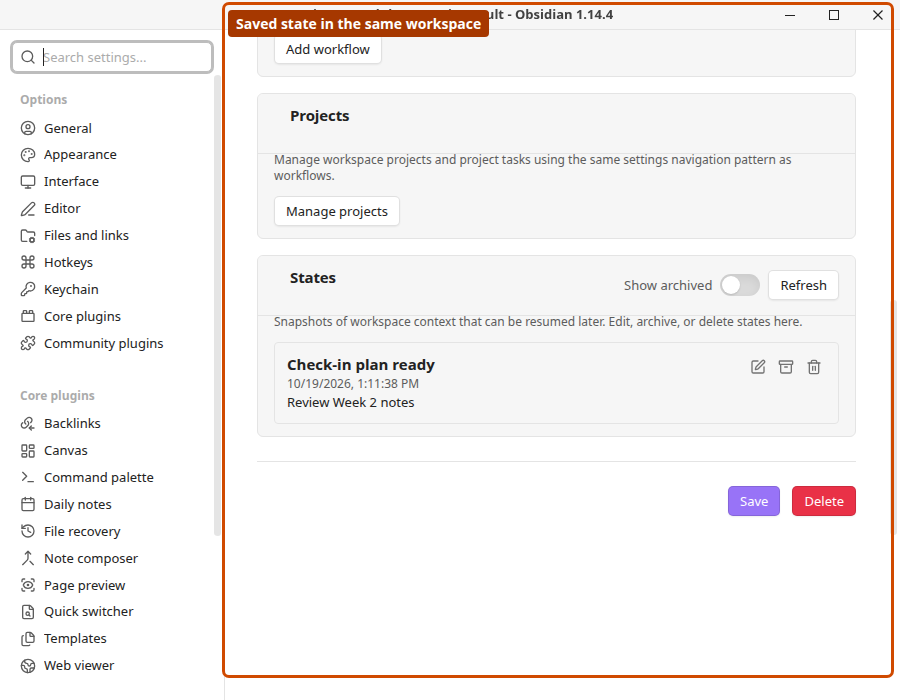
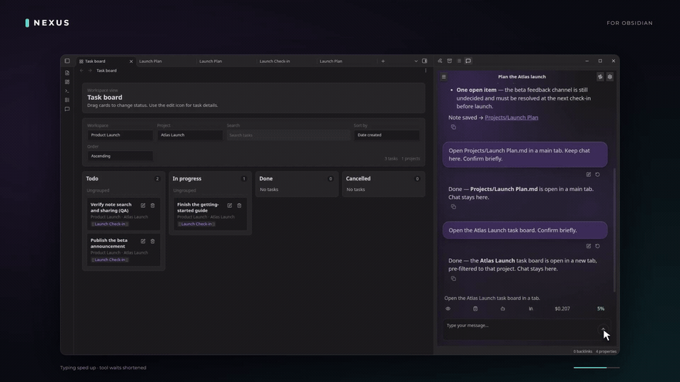
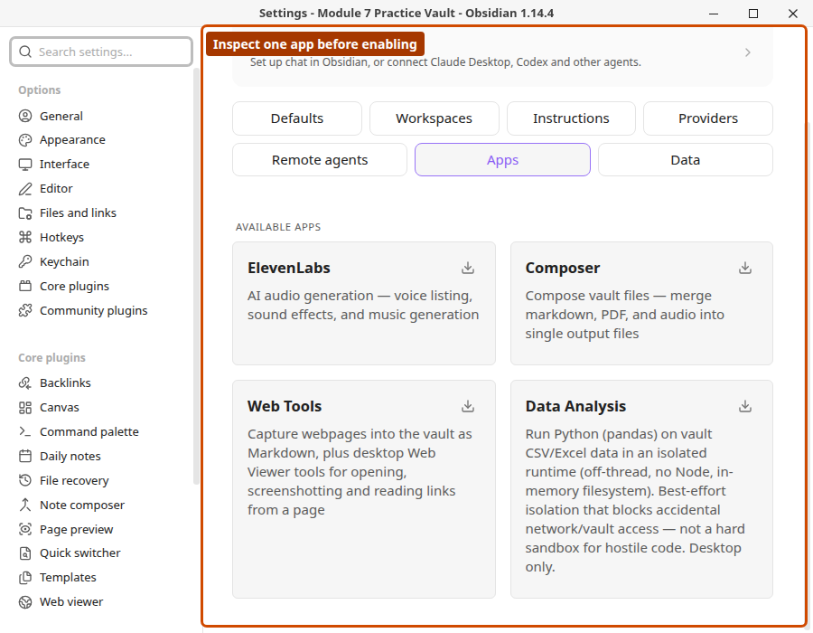

# Nexus visual tour

See how Nexus connects your notes, AI assistants and ongoing work. The workflow
below was captured October 30, 2026 in **released Nexus 5.21.1 / Obsidian 1.14.5
on Linux**, using real Anthropic chat and fictional data. The setup screenshots
were captured October 19 in Obsidian 1.14.4 with providers unconfigured. Your
installed version, enabled apps and operating system can change the labels.

## From meeting notes to a completed task

[Watch the complete 36-second workflow](../media/demos/nexus-chat-workflow.mp4).
The loop above is a 15-second excerpt of the follow-up actions.

Start with the source meeting open in the main workspace. Claude Sonnet 4.6
reads it and saves `Projects/Launch Plan.md`. Continue the conversation:

1. Ask Nexus to open the plan in a main tab.
2. Ask it to open the Atlas Launch task board.
3. Ask it to mark the QA task done, then watch that card move from Todo to Done.

Chat stays in the sidebar while notes and the board occupy the main workspace.
These screen changes are performed by the agent's tools. Typing is accelerated
and long tool waits are shortened; this is not a model-speed benchmark.

Independent readback confirmed the saved plan and the QA status change. Only
that task's status and completion timestamps changed; other task records,
owners, deadlines and note links stayed unchanged. One file-open call used an
unsupported flag, then the model discovered the schema and recovered in the
same turn. See the [verification receipt](../media/chat-workflow-evidence.json).

## Choose how to work

Start with [provider setup](provider-setup.md) for native chat, or connect an
external assistant using [MCP](mcp-setup.md) or the [Nexus CLI](nexus-cli.md).

## Find your settings

Defaults holds shared preferences. Workspaces scopes ongoing work. Instructions
holds prompts and skills; Providers configures native-chat services. Remote
agents, Apps and Data have their own settings areas.

## Give work persistent context

A workspace groups context for ongoing work. Key-file references identify sources;
the agent still needs to read those notes. [Explore workspace memory](workspace-memory.md).

A saved state preserves a restoration checkpoint for later work.

## Turn plans into tracked tasks

The board shows task status. Dependencies are stored relationships and should be
verified in task details or tool results. [Explore task management](task-management.md).

## Add capabilities when you need them

Installing an app makes its capabilities available; it does not prove a completed
run. [Read app requirements and tools](apps.md) before choosing one.

## Learn with guided practice

**[Your AI Second Brain](https://www.synapticlabs.ai/learn/your-ai-second-brain)**
is Synaptic Labs' guided course on building an Obsidian knowledge system with
AI agents, Nexus, skills and workflows. It includes a practice Seed Vault and
step-by-step lessons. These screenshots reuse real application captures prepared
for the course.

Maintaining the documentation? Use the [complete media index](../media/INDEX.md)
to find asset sources and placements, and the [capture workflow](../media/WORKFLOW.md)
to refresh screenshots and short demos.
